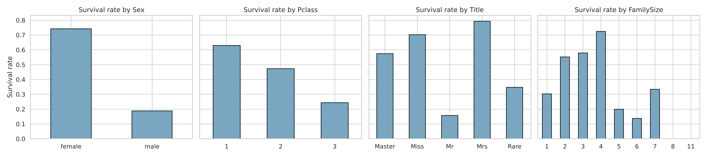
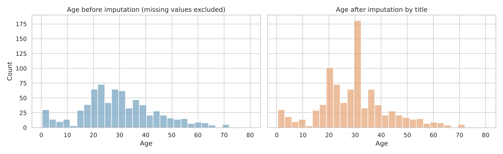
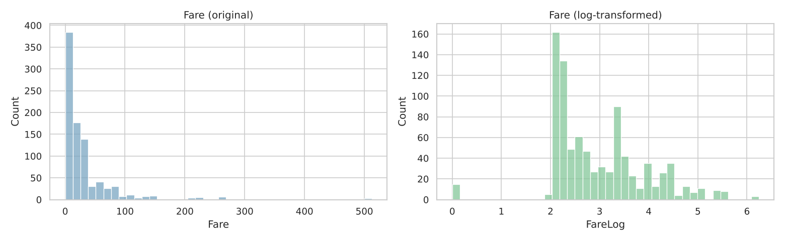

# Titanic Data Cleaning

A step-by-step data-cleaning project in Python that takes the raw Titanic passenger dataset and makes it complete, consistent and ready for analysis. Each decision is explained and backed by the data.




## Overview

The [Titanic dataset](https://www.kaggle.com/c/titanic/data) records 891 passengers: ticket class, name, sex, age, family aboard, fare, cabin, port of embarkation, and whether they survived. Like most real data it has problems:

- **866 missing values** across Age, Cabin and Embarked
- **Heavily skewed fares**, with 116 values flagged as outliers
- **Wrong data types**: categories such as survival and ticket class stored as numbers

The project fixes each of these with a reasoned choice instead of a blanket rule, and ends with a clean dataset that has no missing values.

| Issue | Finding | Action |
|---|---|---|
| Missing Age | 177 rows (20%) | Imputed with the median age for each passenger title |
| Missing Cabin | 687 rows (77%) | Dropped the column; kept a `HasCabin` flag |
| Missing Embarked | 2 rows | Filled with the most common port |
| Fare outliers | 116 above the IQR fence, all genuine | Kept; added a log-transformed `FareLog` (skew 4.8 → 0.4) |
| Duplicates | None | Check kept in the pipeline |
| Wrong types | Survived and Pclass stored as numbers | Converted to categories (Pclass ordered) |
| New features | n/a | `Title`, `FamilySize`, `IsAlone`, `HasCabin`, `FareLog` |

It started as a practice lab during my data science bootcamp (2024). I later revisited it, fixed the bugs, answered the open questions, replaced weak cleaning choices with better-reasoned ones and organised it into a reusable project.

## Walkthrough

The full reasoning, with code and charts, is in [`notebooks/titanic_data_cleaning.ipynb`](notebooks/titanic_data_cleaning.ipynb).

### 1. Explore and classify features
Each column is classified as categorical (nominal or ordinal) or numerical (discrete or continuous). This shows that `Survived` and `Pclass` are stored as integers even though they are categories, so `describe()` reports a meaningless "average class".

### 2. Handle missing values
Dropping every incomplete row would keep only 183 of 891 passengers, so each column is handled on its own terms.

- **Age (20% missing):** the passenger's title is a strong clue to age ("Master" was used for young boys), so each gap is filled with the median age for that title rather than one overall median.

  

- **Cabin (77% missing):** too sparse to impute, so the column is dropped. Whether a cabin was recorded still predicts survival, so that is kept as a `HasCabin` flag.
- **Embarked (2 missing):** filled with the most common port.

### 3. Handle outliers
The IQR rule flags 116 fares, but they are **real first-class tickets, not errors**. The highest (£512) belongs to one party sharing a single ticket. Deleting them would bias the data, so all rows are kept and a log transform reduces the skew.



### 4. Duplicates and data types
There are no duplicates, but the check stays in the pipeline. `Survived`, `Sex`, `Embarked` and `Title` become categories, and `Pclass` becomes an **ordered** category (1st > 2nd > 3rd).

### 5. Feature engineering and first insights
`FamilySize` and `IsAlone` are derived from the family columns. A quick look at survival rates confirms the patterns the cleaned data should show:
- about 74% of women survived compared with 19% of men;
- survival falls from 63% in first class to 24% in third;
- small families (2–4 people) did best, while people travelling alone and large families did worse.

## Project structure

```
titanic-data-cleaning/
├── data/
│   └── README.md          # where the data comes from
├── figures/               # charts produced by the notebook
├── notebooks/
│   └── titanic_data_cleaning.ipynb   # step-by-step walkthrough
├── src/
│   └── cleaning.py        # the same pipeline as a reusable script
├── requirements.txt
└── README.md
```

## Getting started

```bash
git clone https://github.com/FaithNjah/titanic-data-cleaning.git
cd titanic-data-cleaning
pip install -r requirements.txt
```

There's no manual download step: the data is fetched automatically on the first run.

```bash
# Explore the walkthrough
jupyter notebook notebooks/titanic_data_cleaning.ipynb

# Or run the whole pipeline in one command
python src/cleaning.py
```

## Skills demonstrated

- Data auditing and type validation with **pandas**
- Missing-value strategies chosen per column (group-wise imputation, flagging, mode filling)
- Outlier analysis that tells real extreme values apart from errors
- Skew reduction with a log transform
- Feature engineering from text (`Title` taken from `Name`) and from related columns
- Exploratory visualisation with **matplotlib** and **seaborn**
- Turning notebook code into a reusable, documented Python module

## Author

**Faith Njah**: software developer with a background in Medical Physiology.
See also: [Medical Students Data Preprocessing](https://github.com/FaithNjah/medical-students-data-preprocessing)
